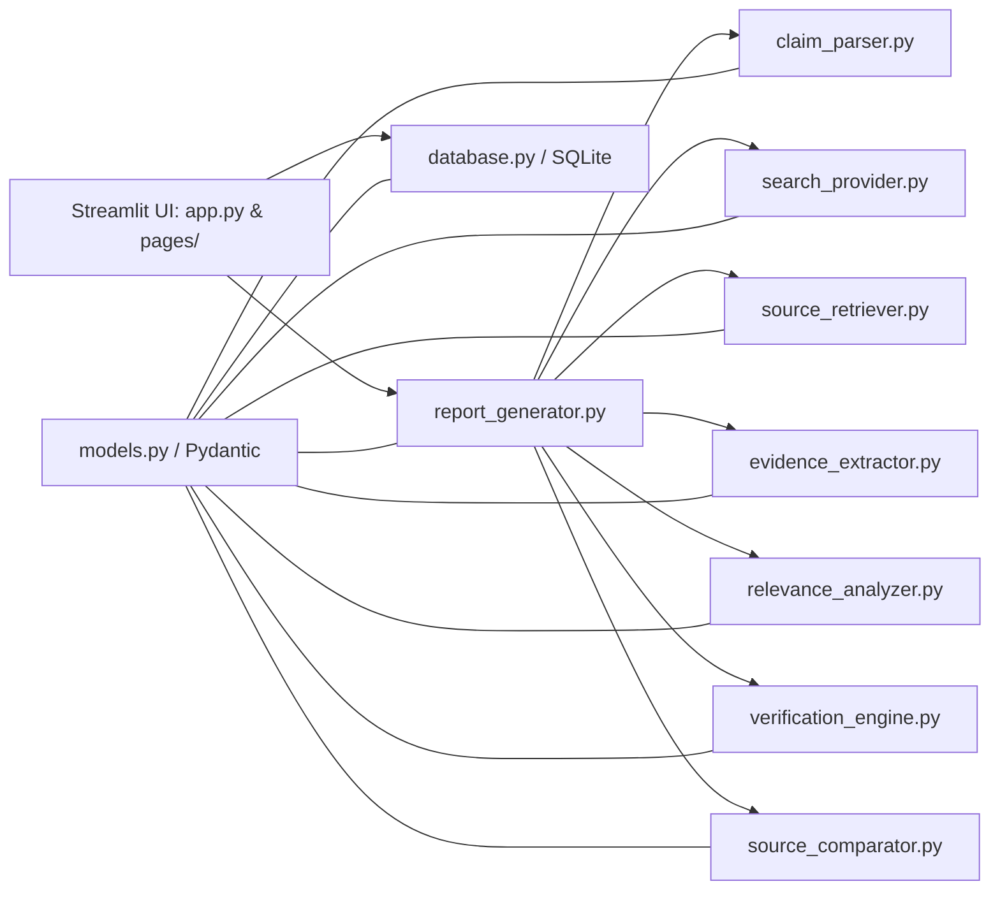

# AI-Powered Fact Verification System

## 1. Project Overview

The **AI-Powered Fact Verification System** is a modular Python 3.13 and Streamlit web application built to help users evaluate factual claims transparently and responsibly. Rather than generating unsupported verdicts or fabricating citations, the system retrieves publicly accessible evidence (via a configurable search API or Manual Evidence Mode), scores topical relevance with transparent NLP methods, compares multiple sources side by side, flags disagreements, persists history in SQLite, and exports structured verification reports in JSON, CSV, and Markdown.

---

## 2. Problem Statement

Readers, students, analysts, and journalists frequently encounter isolated claims online without clear attribution or cross-source context. Many automated tools either:

- Over-rely on surface text similarity and mistakenly treat topically related text as proof,
- Fabricate URLs, publication dates, or citations, or
- Force a binary true/false answer even when evidence is missing, restricted, or contradictory.

This project addresses those gaps by enforcing strict provenance, separating topical relevance from factual stance, disclosing inaccessible sources, and explicitly labeling unresolved conflicts as `UNVERIFIED`.

---

## 3. Key Features

- **Claim Validation & Parsing**: Validates non-empty claims, enforces length limits, splits multi-claim inputs, and extracts keywords, numbers, and negation cues using Pydantic v2.
- **Configurable Source Discovery**: Supports `TavilySearchProvider` and `SerperSearchProvider` through an abstract `SearchProvider` interface, plus `NullSearchProvider` + **Manual Evidence Mode** when no API key is configured.
- **Respectful Public Webpage Retrieval**: Validates URLs (blocking private/loopback addresses), applies request timeouts and size limits, extracts clean text with BeautifulSoup4, and discloses HTTP 401/403/429/451 restrictions without bypassing website controls.
- **Transparent Evidence Analysis**: Uses scikit-learn `TfidfVectorizer` cosine similarity and keyword overlap to rank candidate statements, paired with negation, antonym, refutation, and numeric/date checks to classify evidence as `Supports`, `Contradicts`, or `Unclear`.
- **Conservative Verdicts & Conflict Flagging**: Assigns `SUPPORTED`, `CONTRADICTED`, or `UNVERIFIED`, and flags source disagreements instead of forcing a verdict.
- **Multiple-Source Comparison**: Side-by-side table showing source title, publisher/domain, clickable URL, publication date (when available), excerpt, position, retrieval status, relevance score, and explicit credibility disclaimers.
- **Structured Reports & Exports**: Generates full reports with timestamps, unresolved questions, and limitations, downloadable as **JSON**, **CSV**, and **Markdown**.
- **SQLite Verification History**: Persists completed sessions and reports locally in SQLite so past reports can be filtered, reopened, exported, or deleted.

---

## 4. How the System Works

```mermaid
flowchart TD
    A[User Enters Claim(s)] --> B[Claim Parser & Validator]
    B --> C{Search API Key Configured?}
    C -- Yes --> D[SearchProvider: Tavily / Serper]
    C -- No --> E[Manual Evidence Mode]
    D --> F[Source Retriever & HTML Cleaner]
    E --> F
    F --> G[Evidence Statement Extractor]
    G --> H[TF-IDF & Keyword Relevance Analyzer]
    H --> I[Verification Engine: Polarity, Numeric & Refutation Checks]
    I --> J[Multi-Source Comparator]
    J --> K[Structured Verification Report]
    K --> L[(SQLite History DB)]
    K --> M[JSON / CSV / Markdown Exports]
```

### Step-by-Step Pipeline

1. **Claim Parsing**: Normalizes text, rejects empty or overly long inputs, and extracts keywords, numeric values/years, and negation indicators.
2. **Source Discovery & Retrieval**: Queries a configured search API or reads user-provided sources, keeping retrieved content strictly separated from inaccessible or snippet-only sources.
3. **Evidence Extraction**: Splits accessible text into verbatim candidate sentences while filtering boilerplate navigation and cookie notices.
4. **Relevance Analysis**: Computes TF-IDF cosine similarity and keyword overlap. High relevance indicates topical overlap—never automatic truth.
5. **Stance & Verdict Assignment**: Evaluates negation polarity, refutation phrases, antonym pairs, and numeric/date consistency across sources before assigning `SUPPORTED`, `CONTRADICTED`, or `UNVERIFIED`.
6. **Comparison, Storage & Export**: Summarizes agreements and disagreements across sources, saves the report to SQLite, and enables JSON/CSV/Markdown downloads.

---

## 5. Architecture and Project Structure



```text
ai-fact-verification-system/
├── app.py                              # Streamlit Home Dashboard
├── requirements.txt                    # Python dependencies
├── pyproject.toml                      # Pytest and Ruff configuration
├── README.md                           # Project documentation
├── .env.example                        # Environment variable template
├── .gitignore                          # Git ignore rules
├── data/
│   └── .gitkeep                        # Local SQLite database directory
├── exports/
│   └── .gitkeep                        # Saved JSON / CSV / Markdown exports
├── pages/
│   ├── 1_Verify_Claims.py              # Claim input, discovery, & report preview
│   ├── 2_Source_Comparison.py          # Side-by-side source comparison view
│   ├── 3_Verification_History.py       # SQLite history browser & manager
│   └── 4_About.py                      # Methodology & responsible-use guide
├── src/
│   └── fact_checker/
│       ├── __init__.py
│       ├── models.py                   # Pydantic v2 schemas & enums
│       ├── claim_parser.py             # Input validation & claim splitting
│       ├── search_provider.py          # SearchProvider interface & adapters
│       ├── source_retriever.py         # Safe URL checks & BeautifulSoup4 parsing
│       ├── evidence_extractor.py       # Verbatim candidate statement extraction
│       ├── relevance_analyzer.py       # scikit-learn TF-IDF relevance scoring
│       ├── verification_engine.py      # Stance & conservative verdict logic
│       ├── source_comparator.py        # Multi-source comparison builder
│       ├── report_generator.py         # Report builder, pipeline, & exporters
│       ├── database.py                 # SQLite persistence layer
│       └── ui_helpers.py               # Shared Streamlit UI rendering helpers
└── tests/
    ├── test_claim_parser.py
    ├── test_relevance_analyzer.py
    ├── test_verification_engine.py
    ├── test_source_comparator.py
    ├── test_report_generator.py
    └── test_database.py
```

---

## 6. Technology Stack

- **Language**: Python 3.13 (compatible with Python 3.11–3.13)
- **Web UI**: Streamlit
- **Validation**: Pydantic v2
- **HTTP & HTML Extraction**: Requests + BeautifulSoup4
- **NLP Relevance**: scikit-learn (`TfidfVectorizer` + cosine similarity)
- **Tabular Display**: pandas
- **Storage**: SQLite (`sqlite3`)
- **Environment Config**: `python-dotenv`
- **Testing & Linting**: Pytest and Ruff

---

## 7. Installation Instructions (Windows, macOS, and Linux)

Ensure Python 3.13 (or 3.11+) is installed on your system:

```bash
python --version
```

*(On macOS/Linux, you may need `python3` instead of `python`.)*

Clone or open the repository directory:

```bash
cd ai-fact-verification-system
```

---

## 8. Virtual Environment Setup

### Windows (PowerShell)

```powershell
python -m venv .venv
.venv\Scripts\Activate.ps1
```

### Windows (Command Prompt)

```cmd
python -m venv .venv
.venv\Scripts\activate.bat
```

### macOS & Linux

```bash
python3 -m venv .venv
source .venv/bin/activate
```

---

## 9. Dependency Installation

With your virtual environment activated, upgrade `pip` and install all dependencies:

```bash
pip install --upgrade pip
pip install -r requirements.txt
```

---

## 10. Environment Variable Configuration

Copy `.env.example` to `.env`:

### macOS & Linux

```bash
cp .env.example .env
```

### Windows (PowerShell)

```powershell
Copy-Item .env.example .env
```

Available settings in `.env`:

| Variable | Default | Description |
| --- | --- | --- |
| `SEARCH_PROVIDER` | `auto` | `auto`, `tavily`, `serper`, or `none` |
| `TAVILY_API_KEY` | `""` | Optional Tavily Search API key |
| `SERPER_API_KEY` | `""` | Optional Serper Google Search JSON API key |
| `REQUEST_TIMEOUT_SECONDS` | `8` | HTTP timeout per webpage fetch |
| `MAX_SEARCH_RESULTS` | `5` | Max search results fetched per claim |
| `DATABASE_PATH` | `data/verification_history.db` | Local SQLite database path |
| `EXPORTS_DIR` | `exports` | Directory for saved export files |

---

## 11. Search API Setup (Optional)

**A search API key is completely optional.**

- **Without an API key**: Leave `TAVILY_API_KEY` and `SERPER_API_KEY` empty (or set `SEARCH_PROVIDER="none"`). The application automatically runs in **Manual Evidence Mode**, where you can paste source URLs and text—or load built-in sample scenarios—without making external search API calls.
- **With an API key**: Configure either `TAVILY_API_KEY` (from Tavily) or `SERPER_API_KEY` (from Serper) in `.env`. When `SEARCH_PROVIDER="auto"` (or set to `tavily`/`serper`), the app uses the official JSON API and never scrapes search engine HTML pages.

---

## 12. How to Run the Streamlit Application

```bash
streamlit run app.py
```

Streamlit will start a local server (typically at `http://localhost:8501`) and open the **AI-Powered Fact Verification System** dashboard in your browser.

---

## 13. Example Claims and Sample Workflow

1. Open **Verify Claims** from the sidebar or home page.
2. Expand **Try Sample Verification Scenarios** (or enter your own claim):
   - *Supported*: `"Water boils at 100 degrees Celsius at standard atmospheric pressure."`
   - *Contradicted*: `"The Apollo 11 Moon landing took place in 1975."`
   - *Conflicting Sources*: `"Moderate daily coffee consumption increases heart disease risk."`
   - *Insufficient Evidence*: `"Project Aurora launched a commercial fusion reactor in 2026."`
3. Add or edit source URLs and excerpts (or enable Live Search API if configured).
4. Click **Run Fact Verification**.
5. Review the verdict card, supporting/contradicting evidence, source comparison table, and download the report.

---

## 14. Explanation of `SUPPORTED`, `CONTRADICTED`, and `UNVERIFIED`

| Label | Meaning |
| --- | --- |
| **SUPPORTED** | One or more accessible sources contain relevant evidence matching the claim's key terms, polarity, and numeric/date values, with no contradicting evidence detected. |
| **CONTRADICTED** | Accessible evidence directly conflicts with the claim via explicit refutations (e.g., *"false"*, *"incorrect"*), negation mismatch, antonym conflict, or numeric/date mismatch. |
| **UNVERIFIED** | Available evidence is missing, inaccessible, ambiguous, or sources directly disagree. When sources conflict, the system flags the disagreement and refuses to force a verdict. |

---

## 15. Example Verification Report

```markdown
# Verification Report: `CONTRADICTED`

- **Report ID:** `rep-a1b2c3d4e5`
- **Retrieval Timestamp (UTC):** 2026-11-22T19:45:00+00:00
- **Discovery Mode:** Manual Evidence Mode
- **Confidence Score:** 0.72

## Original Claim
> The Apollo 11 Moon landing took place in 1975.

## Summary & Confidence Explanation
1 retrieved source(s) directly conflict with the claim.
Moderate confidence (0.72) based on a single contradicting source; additional independent sources would strengthen verification.

## Contradicting Evidence
- **[Apollo 11 Mission Summary](https://space-archive.example.org/apollo-11)** (`space-archive.example.org`)
  - Excerpt: "The Apollo 11 Moon landing took place in July 1969, when astronauts Neil Armstrong and Buzz Aldrin walked on the lunar surface."
  - Rationale: Evidence conflicts with the claim: numeric/date mismatch: claim states 1975 while evidence states 1969.
```

---

## 16. Testing Instructions

All unit and integration tests mock external search APIs and HTTP requests so they run offline without any paid API key:

```bash
pytest
```

To run with verbose output or a single test file:

```bash
pytest -v tests/test_verification_engine.py
```

---

## 17. Ruff Linting Instructions

Check code quality, formatting imports, and static rules with Ruff:

```bash
ruff check .
```

To auto-fix safe lint issues if needed:

```bash
ruff check --fix .
```

---

## 18. Export Functionality

Every verification report can be downloaded directly from the UI (or saved to `exports/`):

- **JSON** (`.json`): Full structured Pydantic schema including sources, scores, rationales, comparison rows, unresolved questions, and timestamps.
- **CSV** (`.csv`): Spreadsheet-ready tabular export with one row per compared source.
- **Markdown** (`.md`): Clean human-readable report with clickable links and Markdown comparison tables.

Multi-claim sessions also include batch **Export All (JSON)** and **Export All (CSV)** downloads.

---

## 19. Limitations and Responsible-Use Disclaimer

- **Text similarity is not proof**: TF-IDF cosine similarity measures shared vocabulary, not factual truth.
- **No automatic domain authority**: Publisher domains are displayed for attribution only; domain names alone do not establish credibility.
- **Rule-based NLP boundaries**: Subtle sarcasm, multi-hop reasoning across multiple documents, or heavily paraphrased claims may result in `UNVERIFIED`.
- **Inaccessible and JS-rendered pages**: Paywalled, rate-limited (HTTP 403/429), or JavaScript-only pages are not bypassed and are explicitly reported as inaccessible or snippet-only.
- **Decision support only**: Do not rely solely on automated outputs for medical, legal, financial, or safety-critical decisions.

---

## 20. Future Improvements

- Optional NLI (Natural Language Inference) cross-encoder model support for nuanced paraphrased claims.
- Claim decomposition into atomic sub-claims for compound statements.
- Optional source reliability checklists editable by human reviewers.
- Scheduled re-verification comparisons to track how claims evolve over time.

---

## 21. Contribution Guidelines

1. Fork the repository and create a feature branch.
2. Keep module responsibilities separated under `src/fact_checker/`.
3. Add or update unit/integration tests in `tests/` (mocking all external network calls).
4. Run `pytest` and `ruff check .` before opening a pull request.

---

## 22. License

No `LICENSE` file is currently included in this repository. All rights remain with the repository owner until an explicit open-source or proprietary license file is added.
